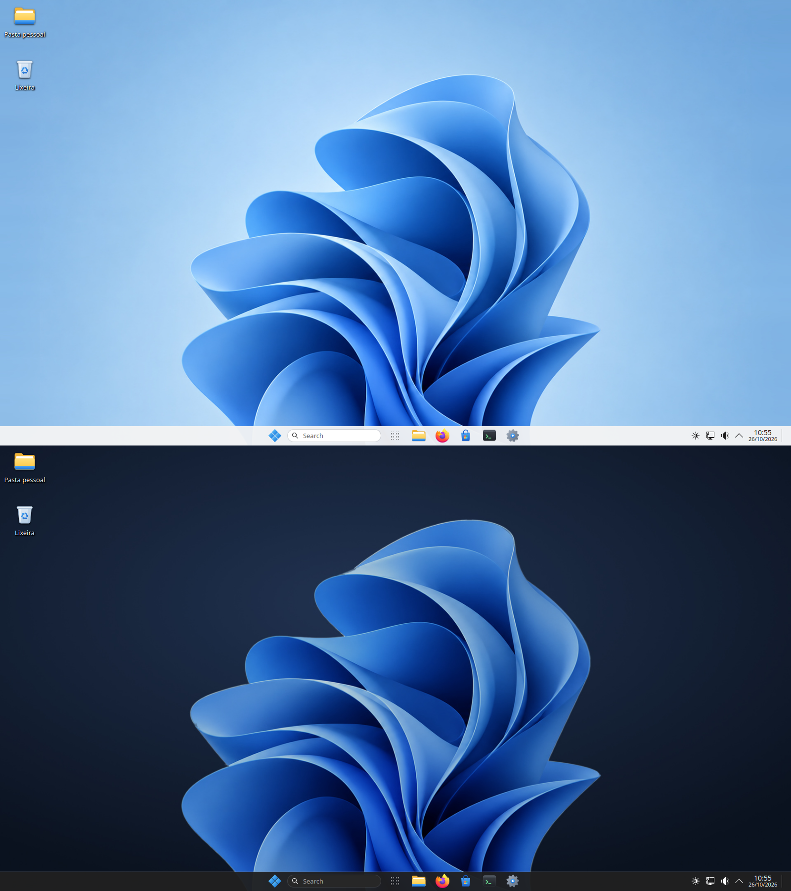
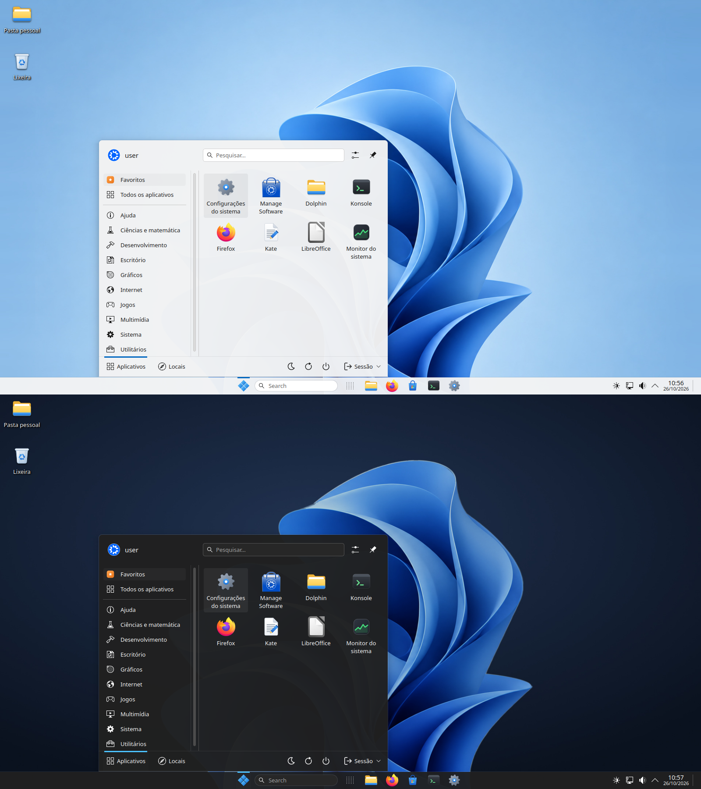
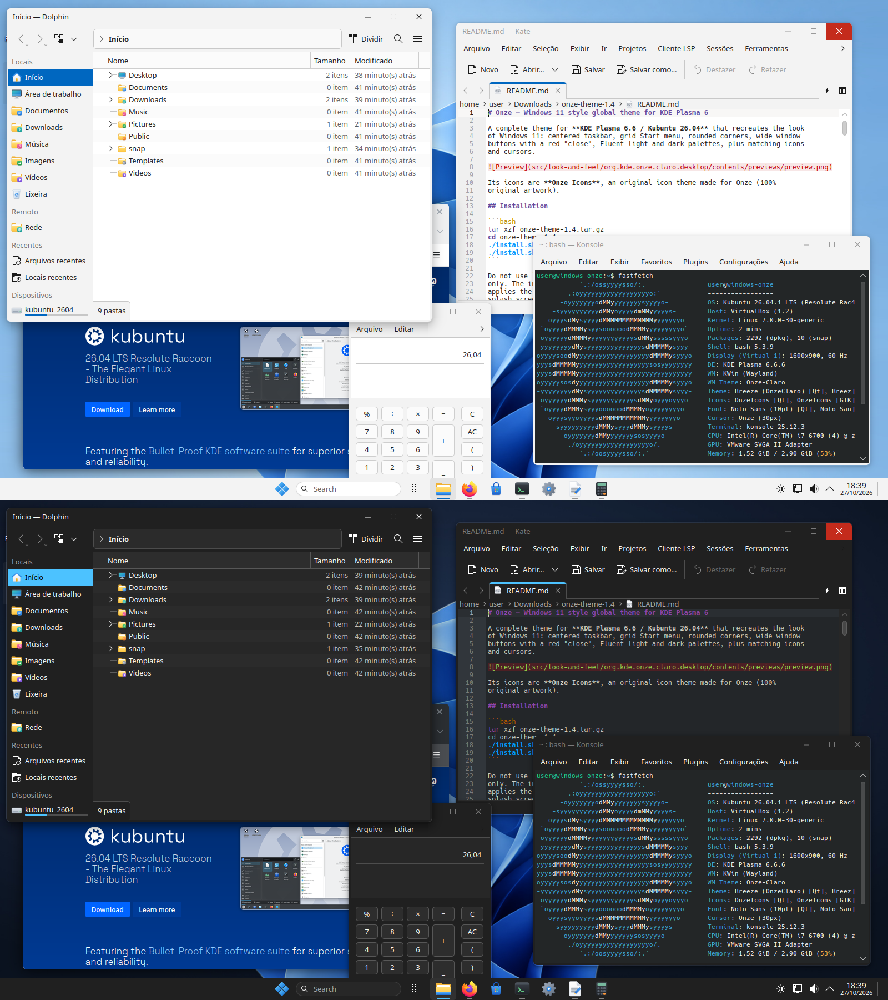
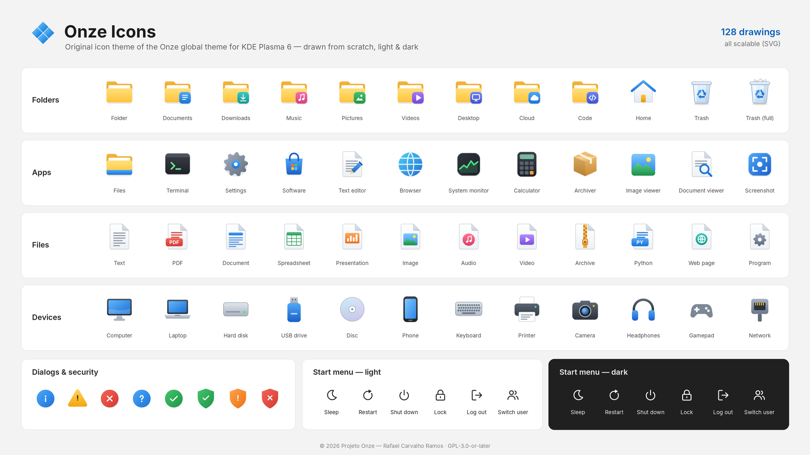

# Windows Onze — Windows 11 style theme for KDE Plasma 6

**Onze** ("eleven" in Portuguese) is a complete global theme for
**KDE Plasma 6.6 / Kubuntu 26.04** that recreates the look of Windows 11:
centered taskbar, grid Start menu, rounded corners, wide window buttons with a
red "close", Fluent light and dark palettes, an original wallpaper, cursors and
icons — installed for your user only, with a script that can undo everything.



## Download

Get `onze-theme-1.4.tar.gz` from the [**latest release**](../../releases/latest).

## Installation

```bash
tar xzf onze-theme-1.4.tar.gz
cd onze-theme-1.4
./install.sh                       # asks: light or dark? center or left? language?
./install.sh --dark --start left   # answers questions up front
```

Do not use `sudo`: everything goes into `~/.local/share` for your user only.
The installer saves your current settings first; `./uninstall.sh` restores
them. All options are described in the README inside the package
([`tools/README.packages.md`](tools/README.packages.md) here).

> The "Install" button of *Get New Global Themes* / the KDE Store does not run
> the script. Download the package and run `install.sh`.

## Screenshots







## What's included

- Global themes **Onze Light** and **Onze Dark** (color schemes, Plasma style,
  Aurorae window decorations, splash screen)
- Taskbar layout: 40 px, items centered (Windows 11) or on the left
  (Windows 10 style), Search, Task View and Show Desktop widgets in English or
  Brazilian Portuguese
- Home folder and Trash on the desktop, scrollbar arrow buttons
- **Onze** cursors and wallpaper (light and dark, 16:9 and 16:10, up to 3840 px)
- **Onze Icons**, an original icon theme: folders, file types, devices, KDE
  apps, dialogs and the Start menu's session buttons

## Repository layout

| Path | Contents |
|---|---|
| `install.sh`, `uninstall.sh` | Installer and uninstaller (no root) |
| `src/` | The theme: look-and-feel, Plasma style, decorations, colors, plasmoids, cursors, wallpaper, Onze Icons |
| `tools/` | Generators (`gerar_tema.py`, `gerar_icones.py`, `gerar_cursores.py`, `prepare_wallpaper.py`), package builder, README of the packages (`README.packages.md`) |
| `tools/store-kit/` | Store listing texts, logo, banner and screenshots |

## Building the packages

```bash
tools/build-packages.sh dist/
```

This writes `onze-theme-<version>.tar.gz` and `onze-theme-store-kit.tar.gz`
to `dist/`. The archives are reproducible:
the same source gives byte-identical files. To regenerate the artwork:

```bash
pip install numpy pillow shapely scipy matplotlib cairosvg
python3 tools/gerar_tema.py       # SVGs, color schemes, previews
python3 tools/gerar_cursores.py   # cursors
python3 tools/gerar_icones.py     # Onze Icons
```

## Credits

A **Projeto Onze** project by **Rafael Carvalho Ramos**
([rafaelramosmacae@gmail.com](mailto:rafaelramosmacae@gmail.com)).
Text labels on some Onze Icons use outlines of the
[Inter](https://rsms.me/inter/) font (SIL Open Font License 1.1).

## License

Onze code and artwork, including Onze Icons: [GPL-3.0-or-later](LICENSE).
Wallpaper (`src/wallpapers/Onze`, `tools/wallpaper/source.png`):
[CC0 1.0 Universal](https://creativecommons.org/publicdomain/zero/1.0/).

Windows is a trademark of Microsoft Corporation. This project is not
affiliated with or endorsed by Microsoft, and contains no Microsoft files or
logos.
